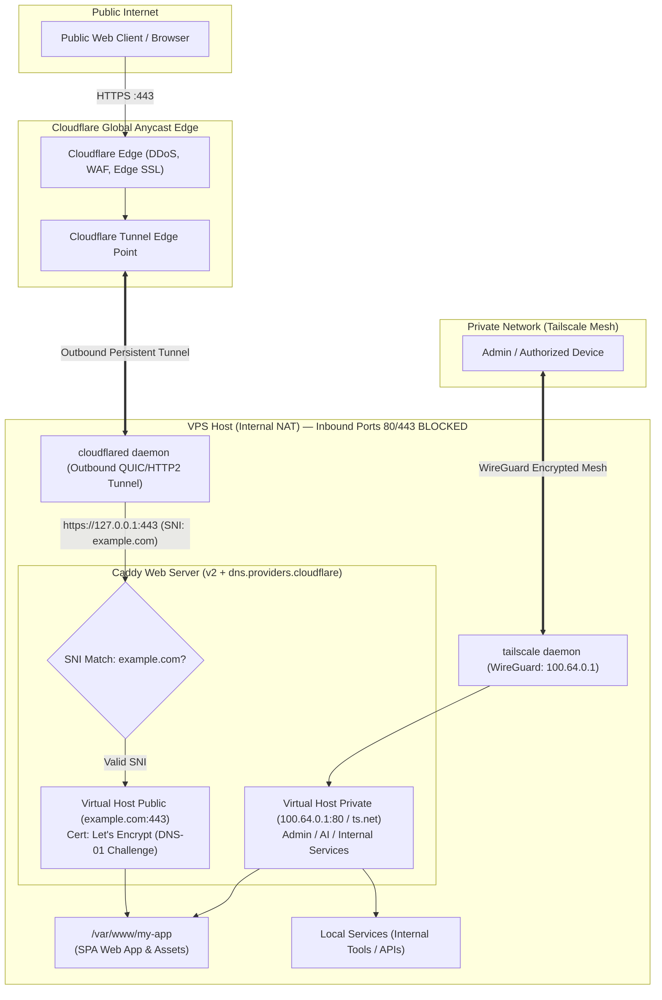

# VPS Hybrid Networking: Tailscale Private & Cloudflare Tunnel + Caddy Public

This skill provides comprehensive setup, configuration, and troubleshooting procedures for a VPS server hosted behind a NAT/CGNAT or firewall where standard inbound ports (`80` & `443`) are blocked by the upstream provider.

This architecture establishes a dual-layer network topology:
1. **Public Ingress**: Securely accessed by the public via Cloudflare Tunnel (`cloudflared`), which routes traffic to a local Caddy reverse proxy equipped with Let's Encrypt certificates issued via DNS-01 challenge.
2. **Private Network**: Server administration, internal tools (admin dashboards, terminal agents, local AI models) are served strictly over Tailscale (WireGuard mesh) without exposing any ports to the public internet.

---

## Network Architecture & Traffic Flow



---

## Security Note: Is `127.0.0.1:443` Safe?

**Yes, routing through `127.0.0.1:443` is an industry best practice:**
- **Loopback Isolation**: `127.0.0.1` is the IPv4 loopback interface (RFC 1122). It can only be communicated with from within the local operating system kernel. It cannot be routed across the internet or reached by external actors.
- **End-to-End Local Encryption**: Using `HTTPS` to `127.0.0.1:443` ensures traffic between the `cloudflared` tunnel connector and Caddy is TLS-encrypted, mitigating unencrypted snooping by other local system processes.
- **Zero Inbound Exposure**: It allows you to bind services solely to loopback and VPN interfaces without opening external ports in firewalls or routers.

---

## Prerequisites & Credentials Matrix

| Component | Provider / Service | Required Access |
|---|---|---|
| Primary Domain | Domain Registrar / Cloudflare | Nameservers delegated to Cloudflare (`*.ns.cloudflare.com`) |
| Cloudflare DNS Token | Cloudflare Dashboard | Token with permission: `Zone.DNS:Edit` for the target zone |
| Cloudflare Zero Trust | Cloudflare One (Zero Trust) | Free or Standard Zero Trust plan to establish Tunnels |
| Tailscale Account | Tailscale Admin Console | Personal or Organization account (SSO) |
| VPS Host | Linux (Debian / Ubuntu 22.04+) | `sudo` / `root` administrative privileges |

---

## Manual User Actions Checklist (Web Console Steps)

The following procedures require manual interaction in the web browser and cannot be automated headlessly without interactive login:

### 1. Cloudflare Dashboard (DNS & API Token)
- [ ] **Delegate Nameservers**: Ensure your domain (e.g., `example.com`) is *Active* in your Cloudflare dashboard.
- [ ] **Create Cloudflare API Token for Caddy DNS-01**:
  1. Navigate to [Cloudflare API Tokens](https://dash.cloudflare.com/profile/api-tokens).
  2. Click **Create Token** &rarr; select the **Edit zone DNS** template.
  3. Token Name: `Caddy DNS-01 Challenge Token`.
  4. Permissions: `Zone` &rarr; `DNS` &rarr; `Edit`.
  5. Zone Resources: `Include` &rarr; `Specific zone` &rarr; select your domain (`example.com`).
  6. Click **Continue to summary** &rarr; **Create Token**.
  7. **COPY AND SAVE THIS TOKEN** (it will only be displayed once).

### 2. Cloudflare Zero Trust (Tunnel & Origin TLS Setup)
- [ ] **Create Cloudflare Tunnel**:
  1. Open [Cloudflare Zero Trust Dashboard](https://one.dash.cloudflare.com/).
  2. Navigate to **Networks** &rarr; **Tunnels** &rarr; click **Add a tunnel**.
  3. Choose **Cloudflared** &rarr; name the tunnel (e.g., `my-vps-tunnel`).
  4. Copy the installation token string (or extract the token value from `--token <TOKEN>`).
- [ ] **Configure Public Hostname & CRITICAL TLS Settings**:
  1. Under the **Public Hostnames** tab of your tunnel, click **Add a public hostname**.
  2. Specify Hostname:
     - Subdomain: *(leave blank for apex, or enter `www`)*
     - Domain: `example.com`
  3. Service:
     - Type: `HTTPS`
     - URL: `127.0.0.1:443`
  4. **CRITICAL STEP (PREVENTS ERROR 525 & TLS INTERNAL HANDSHAKE ERROR)**:
     - Expand **Additional application settings** &rarr; select the **TLS** tab.
     - In the **Origin Server Name** field, enter your public domain:
       ```
       example.com
       ```
     *(Without this setting, `cloudflared` contacts `127.0.0.1` without SNI. Caddy cannot determine which certificate to present and rejects the TLS handshake with `remote error: tls: internal error`).*
  5. Click **Save hostname**.

### 3. Tailscale Admin Console
- [ ] **Authenticate Machine**:
  1. Run `sudo tailscale up` on the server and complete the browser authentication link.
- [ ] **Machine Settings**:
  1. Set the machine name to your desired hostname (e.g., `my-vps`).
  2. (Recommended) **Disable Key Expiry**: In the machine options (`...`), click **Disable key expiry** so the server connection does not expire after 180 days.
  3. Ensure **MagicDNS** is enabled under the **DNS** settings tab (`*.ts.net`).

---

## Step-by-Step Server Setup Guide

### Stage 1: Verify Host Network & Inbound Port Blocking

Verify whether the VPS is behind NAT and confirm inbound port blocking:

```bash
# 1. Inspect local network interface and routing table
ip addr show
ip route show

# 2. Test if external inbound traffic can reach port 80
sudo python3 -m http.server 80 &
# From an external computer: curl -I http://<PUBLIC_IP> --connect-timeout 5
# If the request times out, inbound ports 80/443 are confirmed blocked upstream.
sudo killall python3
```

---

### Stage 2: Private Network Setup via Tailscale

```bash
# 1. Install Tailscale from its official apt repository (no pipe-to-shell installer).
#    Replace <distro> with ubuntu or debian and <codename> with your
#    release codename (e.g. noble for Ubuntu 24.04, bookworm for Debian 12).
curl -fsSL https://pkgs.tailscale.com/stable/<distro>/<codename>.noarmor.gpg | sudo tee /usr/share/keyrings/tailscale-archive-keyring.gpg >/dev/null
curl -fsSL https://pkgs.tailscale.com/stable/<distro>/<codename>.tailscale-keyring.list | sudo tee /etc/apt/sources.list.d/tailscale.list
sudo apt-get update && sudo apt-get install -y tailscale

# 2. Connect machine to your Tailnet
sudo tailscale up --hostname=my-vps --accept-routes

# 3. Retrieve assigned Tailscale IPv4 address (100.64.0.0/10 CGNAT range)
tailscale ip -4
# Example output: 100.64.0.1

# 4. Check Tailnet node status
tailscale status
```

---

### Stage 3: Install Caddy with Cloudflare DNS-01 Plugin

Standard distribution packages lack the Cloudflare DNS plugin. Download or build Caddy with `github.com/caddy-dns/cloudflare`.

```bash
# Download official custom Caddy binary with Cloudflare DNS plugin
curl -o /tmp/caddy "https://caddyserver.com/api/download?os=linux&arch=amd64&p=github.com%2Fcaddy-dns%2Fcloudflare"
chmod +x /tmp/caddy
sudo mv /tmp/caddy /usr/bin/caddy

# Verify the plugin is installed
/usr/bin/caddy list-modules | grep dns.providers.cloudflare
```

---

### Stage 4: Multi-Tier Caddyfile Configuration (Public & Private)

Create or update `/etc/caddy/Caddyfile`:

```caddy
{
	debug
}

# -----------------------------------------------------------------------------
# PRIVATE ENDPOINTS (Accessible Only via Tailscale Mesh Network)
# -----------------------------------------------------------------------------

# Internal Admin Terminal / Tool (e.g., ttyd)
agent.example.com {
	tls {
		dns cloudflare <YOUR_CLOUDFLARE_API_TOKEN>
		resolvers 1.1.1.1:53
	}
	basic_auth /* {
		admin <SECURE_BCRYPT_HASH_FROM_caddy_hash_password>
	}
	reverse_proxy 127.0.0.1:7681
}

# Internal AI / LLM API Gateway
ai.example.com {
	tls {
		dns cloudflare <YOUR_CLOUDFLARE_API_TOKEN>
		resolvers 1.1.1.1:53
	}
	reverse_proxy 127.0.0.1:8080
}

# Dedicated Tailscale IP Endpoint (Accessible strictly via Tailscale IP)
http://100.64.0.1 {
	root * /var/www/my-app
	encode gzip zstd
	file_server
	try_files {path} /index.html
}

# -----------------------------------------------------------------------------
# PUBLIC ENDPOINTS (Served via Cloudflare Tunnel)
# -----------------------------------------------------------------------------
example.com, www.example.com {
	tls {
		dns cloudflare <YOUR_CLOUDFLARE_API_TOKEN>
		resolvers 1.1.1.1:53
	}

	# Redirect Canonical WWW -> Apex
	@www host www.example.com
	redir @www https://example.com{uri} permanent

	# API Catalog & Metadata Headers (Optional)
	@api_catalog path /.well-known/api-catalog
	header @api_catalog Content-Type application/linkset+json

	@api_health path /api/v1/health
	header @api_health Content-Type application/json

	# Content Negotiation for AI / LLM Agents (Optional)
	@markdown {
		header Accept *text/markdown*
		not path *.webp *.svg *.jpg *.png *.css *.js *.json *.xml
	}
	rewrite @markdown /index.md
	header @markdown Content-Type "text/markdown; charset=utf-8"
	header @markdown Vary "Accept"

	# Static Web Application Routing
	root * /var/www/my-app
	encode gzip zstd
	file_server
	try_files {path} /index.html
}
```

Format, validate, and reload Caddy:
```bash
sudo caddy fmt --overwrite /etc/caddy/Caddyfile
sudo caddy validate --config /etc/caddy/Caddyfile
sudo systemctl restart caddy
```

---

### Stage 5: Configure Cloudflare Tunnel Daemon (`cloudflared`)

```bash
# 1. Install cloudflared package
curl -fsSL https://pkg.cloudflare.com/cloudflare-main.gpg | sudo tee /usr/share/keyrings/cloudflare-main.gpg >/dev/null
echo 'deb [signed-by=/usr/share/keyrings/cloudflare-main.gpg] https://pkg.cloudflare.com/cloudflared noble main' | sudo tee /etc/apt/sources.list.d/cloudflared.list
sudo apt-get update && sudo apt-get install -y cloudflared

# 2. Store the tunnel token in a protected file
sudo mkdir -p /etc/cloudflared
sudo tee /etc/cloudflared/token > /dev/null <<'EOF'
<YOUR_CLOUDFLARE_TUNNEL_TOKEN>
EOF
sudo chmod 600 /etc/cloudflared/token

# 3. Create Systemd Service File: /etc/systemd/system/cloudflared.service
sudo tee /etc/systemd/system/cloudflared.service > /dev/null <<'EOF'
[Unit]
Description=Cloudflare Tunnel client
After=network-online.target
Wants=network-online.target

[Service]
TimeoutStartSec=15
Type=notify
ExecStart=/usr/bin/cloudflared --no-autoupdate tunnel run --token-file /etc/cloudflared/token
Restart=on-failure
RestartSec=5s

[Install]
WantedBy=multi-user.target
EOF

# 4. Reload systemd and start the tunnel daemon
sudo systemctl daemon-reload
sudo systemctl enable --now cloudflared
sudo systemctl status cloudflared
```

---

## Smoke Testing & Verification

### 1. Test Public End-to-End Ingress (Cloudflare Edge -> Tunnel -> Caddy)
```bash
curl -IL https://example.com
```
Expected output:
- `HTTP/2 200 OK`
- `server: cloudflare`
- `content-type: text/html; charset=utf-8`

### 2. Test Content Negotiation (Markdown for Agents)
```bash
curl -H "Accept: text/markdown" https://example.com/
```
Expected output:
- `Content-Type: text/markdown; charset=utf-8`

### 3. Test Private Tailscale Ingress
From an authorized device within the same Tailnet:
```bash
curl -I http://100.64.0.1
```
Expected output:
- `HTTP/1.1 200 OK`
- `server: Caddy`

---

## Troubleshooting Guide & Runbook

### Issue 1: Cloudflare Error 525 (SSL Handshake Failed) / `remote error: tls: internal error`

* **Symptoms**: Browser displays Cloudflare Error 525. Caddy logs (`journalctl -u caddy -n 50`) show:
  ```
  http: TLS handshake error from 127.0.0.1:...: remote error: tls: internal error
  ```
* **Root Cause**: `cloudflared` forwards requests to `https://127.0.0.1:443`. By default, `cloudflared` sends the loopback IP or empty SNI. Caddy has certificates for `example.com`, but no certificate exists for `127.0.0.1`, causing Caddy to reject the TLS handshake.
* **Resolution**:
  1. Open **Cloudflare Zero Trust** &rarr; **Networks** &rarr; **Tunnels**.
  2. Edit your active tunnel &rarr; open the **Public Hostnames** tab &rarr; edit `example.com`.
  3. Expand **Additional application settings** &rarr; select **TLS**.
  4. In **Origin Server Name**, enter your domain name:
     ```
     example.com
     ```
  5. Save the configuration. `cloudflared` will automatically reload without requiring a service restart.

---

### Issue 2: Let's Encrypt DNS-01 Challenge Failure or Timeout

* **Symptoms**: Caddy log reports:
  ```
  [ERROR] [example.com] error presenting token: ... status code 403: unauthorized / Invalid request headers
  ```
* **Root Causes**:
  1. The Cloudflare API Token lacks `Zone.DNS:Edit` permissions.
  2. The token is restricted to an incorrect zone.
  3. DNS propagation delay during TXT record validation.
* **Resolution**:
  1. Ensure the token was created under **User API Tokens** (not the Global API Key).
  2. Confirm permissions include `Zone: DNS: Edit`.
  3. Specify upstream Cloudflare resolvers in the `tls` block so Caddy validates TXT records against authoritative nameservers directly:
     ```caddy
     resolvers 1.1.1.1:53
     ```

---

### Issue 3: `cloudflared.service` Crash / Restart Loop

* **Symptoms**: `systemctl status cloudflared` indicates `activating (auto-restart)` or failure exit codes.
* **Diagnostics**:
  ```bash
  journalctl -u cloudflared -e --no-pager
  ```
* **Resolution**:
  1. Check if `/etc/cloudflared/token` is empty or contains unwanted trailing whitespaces.
  2. Verify file permissions: Ensure `/etc/cloudflared/token` is readable (`chmod 600 /etc/cloudflared/token`).
  3. Verify outbound internet connectivity to Cloudflare Edge ports (UDP/TCP `7844` or `443`):
     ```bash
     curl -v https://region1.v2.argotunnel.com
     ```

---

### Issue 4: Tailscale Connectivity Interruption

* **Diagnostics**:
  ```bash
  sudo tailscale status
  sudo tailscale ping <PEER_TAILSCALE_IP>
  ```
* **Resolution**:
  1. If status indicates `NeedsLogin`, re-run `sudo tailscale up`.
  2. If the node key expired, open the Tailscale Admin Console and select **Disable key expiry**.
  3. If blocked by a local firewall, explicitly allow traffic on the `tailscale0` interface:
     ```bash
     sudo ufw allow in on tailscale0 to any
     ```
